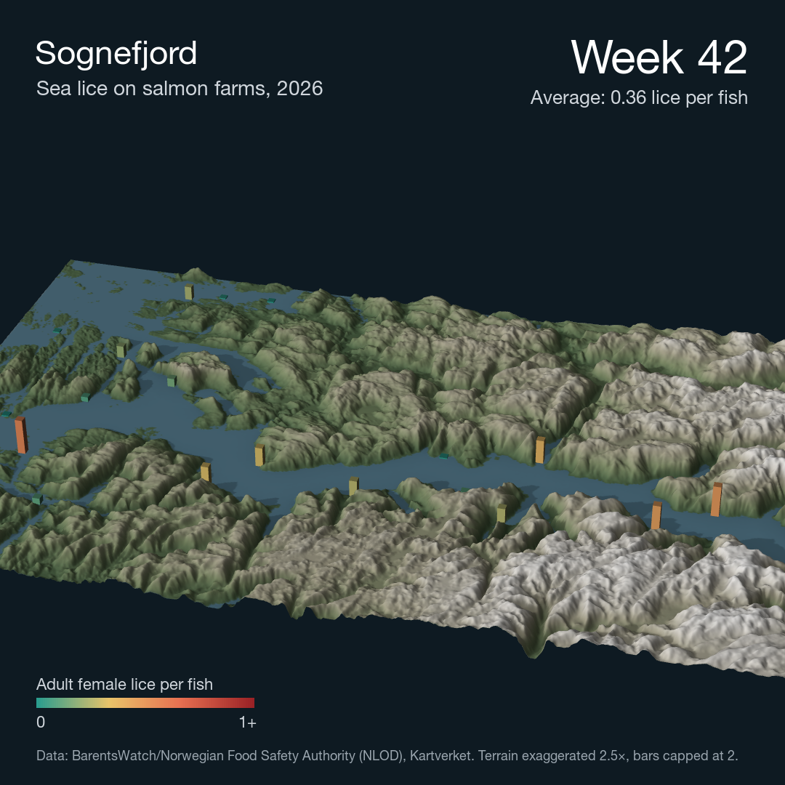

# Norway's fjords in 3D with sea lice on top

A 3D video of the outer Sognefjord where every salmon farm is a bar. Height and colour show adult female lice per fish, week by week from May to mid-October 2026 (weeks 18–42).



## Run

Open `Geospatial.Rproj` and run [koer.R](koer.R). The whole pipeline is one function:

```r
lav_video("sognefjorden", aar = 2026, uger = 18:42)
lav_video("hardangerfjorden", aar = 2026, uger = 18:42)   # another fjord, same code
lav_video("sognefjorden", aar = 2026, uger = 18:42, kun_frames = c(1, 400, 725))   # quick test of single frames
```

New fjords are added as a bounding box in [R/omraader.R](R/omraader.R).

Output: `output/<fjord>_<year>.mp4` (1080×1080, 25 fps, about 29 s) and `output/<fjord>_<year>_slut.png` (final still showing the worst week).

## Data

| Data | Source | Access |
|---|---|---|
| Terrain model (DTM), 100 m | Kartverket, WCS `wcs.hoyde-dtm-nhm-25833` (CC BY 4.0) | Open, no login. Downloaded automatically to `data/raw/` |
| Weekly lice counts per farm (reported counts, not a forecast) | BarentsWatch / Norwegian Food Safety Authority (NLOD) | Bulk export `lusetal_<year>.csv` in `data/raw/`, same file as the [lakselus](https://github.com/mebindner/lakselus) project. The 2026 file was downloaded on 28 October 2026 |

## Method

1. Bounding box for the fjord, then the DTM at 100 m resolution (EPSG:25833).
2. Terrain texture with `height_shade` plus shadows (`lamb_shade`, `ray_shade`, `ambient_shade`). Water is every cell at 0 m. The texture is cached in `data/processed/`.
3. Lice counts are filtered to the area and interpolated linearly between weeks, so the bars grow smoothly.
4. Bars are drawn as 3D boxes with `rgl` on top of the rayshader scene.
5. One render per video frame: 5 s intro without bars, 20 s from week 18 to the worst week, 4 s still. Text is added with `magick` and the video is assembled with `ffmpeg`.

## Limitations

- No bathymetry. The fjord is a flat surface at 0 m.
- Terrain is exaggerated 2.5× (`zscale = 40` at 100 m resolution), and bars are capped at 2 lice per fish.
- Farms with no count in a given week (fallow or no fish) are not shown.
- The limit is 0.5 adult female lice per fish for most of the year, but 0.2 in spring weeks. The colour scale does not use the limit.
- The most recent week is often incomplete, so the video stops one week before the latest data.

## Technical note (macOS)

rgl needs XQuartz. After installing it, log out and back in once. Otherwise R has no display, and rayshader falls back to a software renderer that draws the terrain but not the bars.
