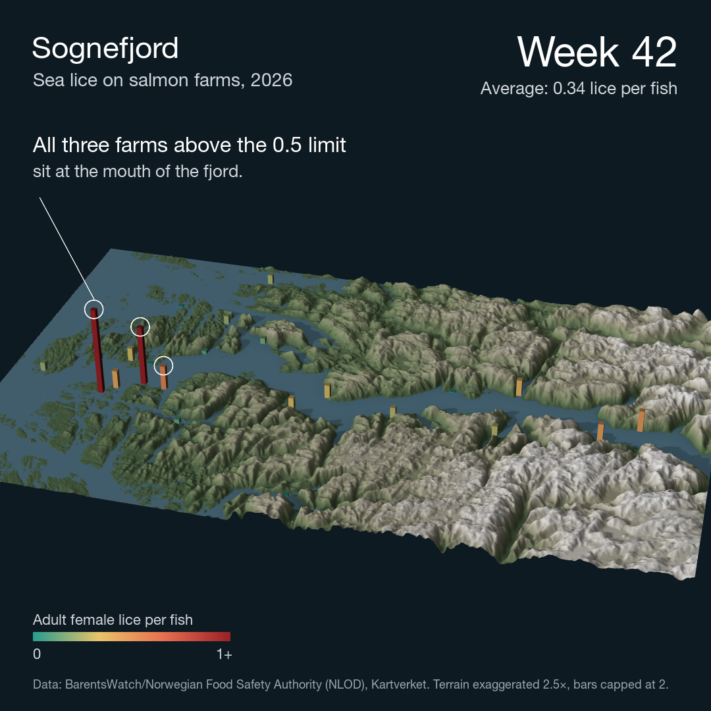

# Norway's fjords in 3D with sea lice on top

A 3D video of the outer Sognefjord where every salmon farm is a bar. Height and colour show adult female lice per fish, week by week from late April to mid-October 2026 (weeks 18–42).



https://github.com/user-attachments/assets/49daf353-767c-43c3-a8a0-9a626ab44623

In week 42 the average across reporting farms was 0.34 adult female lice per fish. Three farms were above Norway's 0.5 limit, and all three sit at the mouth of the fjord.

## Run

Open `Geospatial.Rproj` and run [run.R](run.R). It does three things:

```r
check_visibility("sognefjord", year = 2026, weeks = 18:42)   # every farm in the numbers is on screen
make_video("sognefjord", year = 2026, weeks = 18:42,
           conclusion = c("All three farms above the 0.5 limit", "sit at the mouth of the fjord."))
```

A new fjord is one bounding box in [R/areas.R](R/areas.R) and one call: `make_video("hardangerfjord", ...)`.

Output: `output/sognefjord_2026.mp4` (1080×1080, 25 fps, 31 s) and `output/sognefjord_2026_final.png`.

## Code

| File | Responsibility |
|---|---|
| [R/areas.R](R/areas.R) | Bounding boxes and display names for each fjord |
| [R/elevation.R](R/elevation.R) | Download Kartverket's terrain model at the chosen resolution |
| [R/lice.R](R/lice.R) | Read the BarentsWatch lice export, interpolate between weeks |
| [R/scene.R](R/scene.R) | Terrain texture, bars, camera path |
| [R/annotate.R](R/annotate.R) | Titles, week counter, legend, source line and conclusion |
| [R/video.R](R/video.R) | `make_video()`: the full pipeline for one fjord and year |
| [R/checks.R](R/checks.R) | `check_visibility()`: quality check before rendering |

## Data

| Data | Source | Access |
|---|---|---|
| Terrain model (DTM), 100 m | Kartverket, WCS `wcs.hoyde-dtm-nhm-25833` (CC BY 4.0) | Open, no login. Downloaded automatically to `data/raw/` |
| Weekly lice counts per farm (reported counts, not a forecast) | BarentsWatch / Norwegian Food Safety Authority (NLOD) | Bulk export `lusetal_<year>.csv` in `data/raw/`, from the same pipeline as [lakselus](https://github.com/mebindner/lakselus). The 2026 file was downloaded on 28 October 2026 |

## Method

1. **Area.** A bounding box around the fjord, wide enough that farms at the fjord mouth do not sit on the edge of the terrain.
2. **Terrain.** Kartverket's DTM at 100 m (EPSG:25833). Sea is every cell at 0 m. Texture from `height_shade` plus three shadow layers (`lamb_shade`, `ray_shade`, `ambient_shade`) with a low south-western sun.
3. **Lice.** Weekly counts filtered to the box. Between weeks the bar heights are interpolated linearly so they grow smoothly, but the average shown on screen is always the exact reported average for the week in the counter.
4. **Bars.** One 3D box per farm, drawn with `rgl`. Height is capped at 2 lice per fish; colour saturates at 1.
5. **Video.** 5 s intro without bars, 20 s from week 18 to week 42, 6 s hold on the latest week. The conclusion fades in during the hold, with circles on the farms above the limit. Text is added with `magick` and the video is encoded with `ffmpeg`.
6. **Quality check.** `check_visibility()` projects every farm's bar to screen coordinates across the video and fails if any is cropped or hidden under text. This was added after an earlier render cropped two farms out of view while still counting them in the average.

## Limitations

- One week and three farms: the map shows where counts were high, not why.
- Only farms that reported counts in a given week are shown and counted.
- No bathymetry: the fjord is a flat surface at 0 m.
- Terrain is exaggerated 2.5× (`zscale = 40` at 100 m), and bars are capped at 2 lice per fish. Both are stated on every frame.
- The limit is 0.5 adult female lice per fish for most of the year and 0.2 in spring weeks. The colour scale is fixed and does not follow the limit.
- The most recent week is usually incomplete, so the video stops one week before the latest data.

## Technical note (macOS)

rgl needs XQuartz. After installing it, log out and back in once. Without a display, rayshader falls back to a software renderer that draws the terrain but not the bars.
