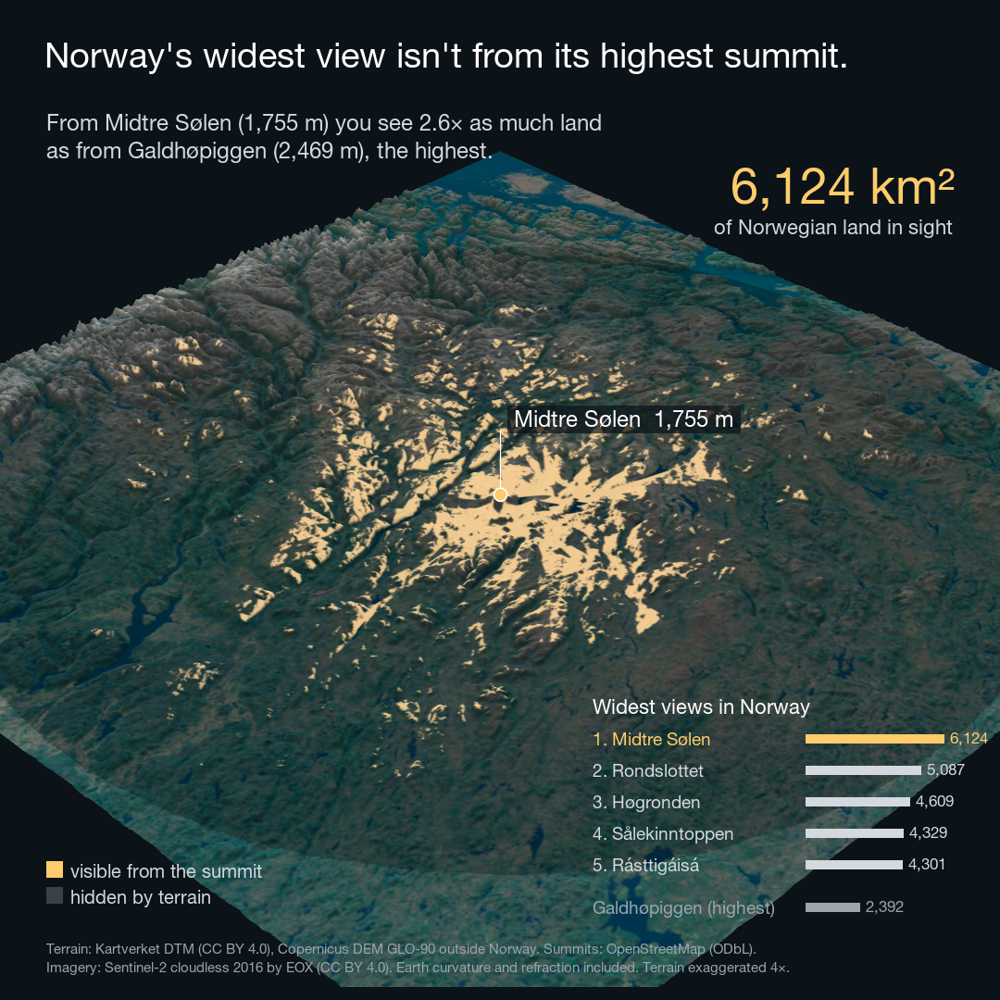

# Norway's widest view

Which Norwegian summit lets you see the most land? Not the highest one.

From **Midtre Sølen** (1,755 m) in Rendalen you can see **6,124 km²** of Norwegian land, 2.6 times as much as from **Galdhøpiggen** (2,469 m), Norway's highest summit, which is hemmed in by the other peaks of Jotunheimen.

| Rank | Summit | Height | Visible land (100 m model) | Furthest visible land |
|---|---|---|---|---|
| 1 | Midtre Sølen | 1,755 m | 6,124 km² | 187 km |
| 2 | Rondslottet | 2,178 m | 5,087 km² | 195 km |
| 3 | Høgronden | 2,115 m | 4,609 km² | 190 km |
| 4 | Sålekinntoppen | 1,591 m | 4,329 km² | 136 km |
| 5 | Rásttigáisá | 1,067 m | 4,301 km² | 169 km |
| – | Galdhøpiggen (highest) | 2,469 m | 2,392 km² | |

## Run

Open `Geospatial.Rproj` and run [run.R](run.R). Each stage caches its result in `data/processed`, so re-running is cheap. The first full run downloads about 1.5 GB of elevation data and takes roughly an hour, most of it rendering.

## Method

1. **Terrain.** Kartverket's national terrain model (DTM) for Norway. Outside Norway Kartverket is 0 m, so the neighbouring countries are filled with Copernicus DEM GLO-90; otherwise the Swedish mountains would be a flat plane and summits near the border would see straight through them. Only Norwegian land is counted.
2. **Summits.** Every named OpenStreetMap summit with an elevation of at least 1,000 m: 4,869 candidates, of which 8 were excluded because their OSM elevation disagrees with the terrain by more than plausible.
3. **Visibility.** For each summit, a viewshed from 1.7 m above the summit (eye height), with Earth curvature and standard atmospheric refraction (GDAL, `curvcoef = 6/7`), out to 350 km. Because a grid cell holds the average height of its area, the observer is lifted from the cell to the true summit height.
4. **Three resolutions.** All summits are screened at 500 m. The best 40 distinct summits (one per 3 km) are re-ranked at 200 m. The top 5, and Galdhøpiggen for comparison, are computed at 100 m.
5. **Video.** The 100 m visibility layer, aggregated exactly to a 400 m scene grid, on top of Sentinel-2 cloudless imagery and the terrain in 3D (rayshader). The on-screen counter adds up visible area by distance and ends exactly on the 100 m result.

## Checks

| Check | Result |
|---|---|
| Viewshed on a flat plane vs. the theoretical horizon (with refraction) | 1,000 m eye: 122.7 km vs 121.9 km. 2,000 m: 173.2 km vs 172.4 km. Both within one cell |
| Same winner at 500 m and 200 m | Yes |
| Rank agreement 500 m vs 200 m (top 40) | Spearman 0.83, top 10 overlap 9/10 |
| Visible land inside the video frame, all frames | 100% (the check was verified to fail on a deliberately cropped camera) |

## Results depend on resolution, the ranking does not

Visible areas shrink as the terrain gets more detailed, because finer terrain hides more of the small valleys:

| | 500 m | 200 m | 100 m |
|---|---|---|---|
| Midtre Sølen | 8,196 km² | 6,786 km² | 6,124 km² |
| Galdhøpiggen | 4,106 km² | – | 2,392 km² |

The steps get smaller (−17%, then −10%), so the numbers are converging but not final; at 10 m they would be lower still. The **ranking** is what the analysis supports: the same winner at every resolution, and Galdhøpiggen falls faster than the winner as detail increases, so the comparison only gets stronger. Galdhøpiggen ranked 56th of 2,807 distinct summits in the 500 m screening; that rank is not recomputed at 100 m.

## Limitations

- "Visible" means a clear line of sight. Haze and weather limit real views long before 150–190 km.
- Only Norwegian land is counted. Sea, Swedish and Finnish land in view are not.
- The terrain model is bare earth: forests and buildings that could block a view are not included (the Copernicus fill outside Norway is a surface model and does include them).
- Candidates are named OSM summits of at least 1,000 m. An unnamed or lower top with a wide view would be missed.
- The video exaggerates the terrain 4× for legibility; this is stated on every frame.

## Data

| Data | Source | Licence |
|---|---|---|
| Terrain, Norway | Kartverket, WCS `wcs.hoyde-dtm-nhm-25833` | CC BY 4.0 |
| Terrain, neighbouring countries | Copernicus DEM GLO-90 (© DLR e.V. 2010–2014 and © Airbus Defence and Space GmbH 2014–2018, provided under COPERNICUS by the European Union and ESA) | Copernicus DEM licence |
| Summits | OpenStreetMap contributors, via Overpass | ODbL |
| Imagery | Sentinel-2 cloudless 2016 by EOX IT Services (s2maps.eu), contains modified Copernicus Sentinel data 2016 | CC BY 4.0 |

## Code

| File | Responsibility |
|---|---|
| [R/grid.R](R/grid.R) | Analysis grid and resolutions |
| [R/elevation.R](R/elevation.R) | Kartverket DTM plus Copernicus fill, Norwegian land mask |
| [R/peaks.R](R/peaks.R) | Named summits from OpenStreetMap |
| [R/viewshed.R](R/viewshed.R) | Visible land from one summit, parallel scoring |
| [R/pipeline.R](R/pipeline.R) | Screening, re-ranking, final 100 m numbers, reference summits |
| [R/checks.R](R/checks.R) | Horizon check, OSM elevation check, rank agreement, frame coverage |
| [R/imagery.R](R/imagery.R) | Sentinel-2 cloudless imagery on the scene grid |
| [R/scene.R](R/scene.R) | 3D scene and the reveal texture |
| [R/annotate.R](R/annotate.R) | On-screen text, counter and ranking panel |
| [R/video.R](R/video.R) | Frame rendering and video encoding |
| [video_story.R](video_story.R) | Builds the on-screen story from the results |
