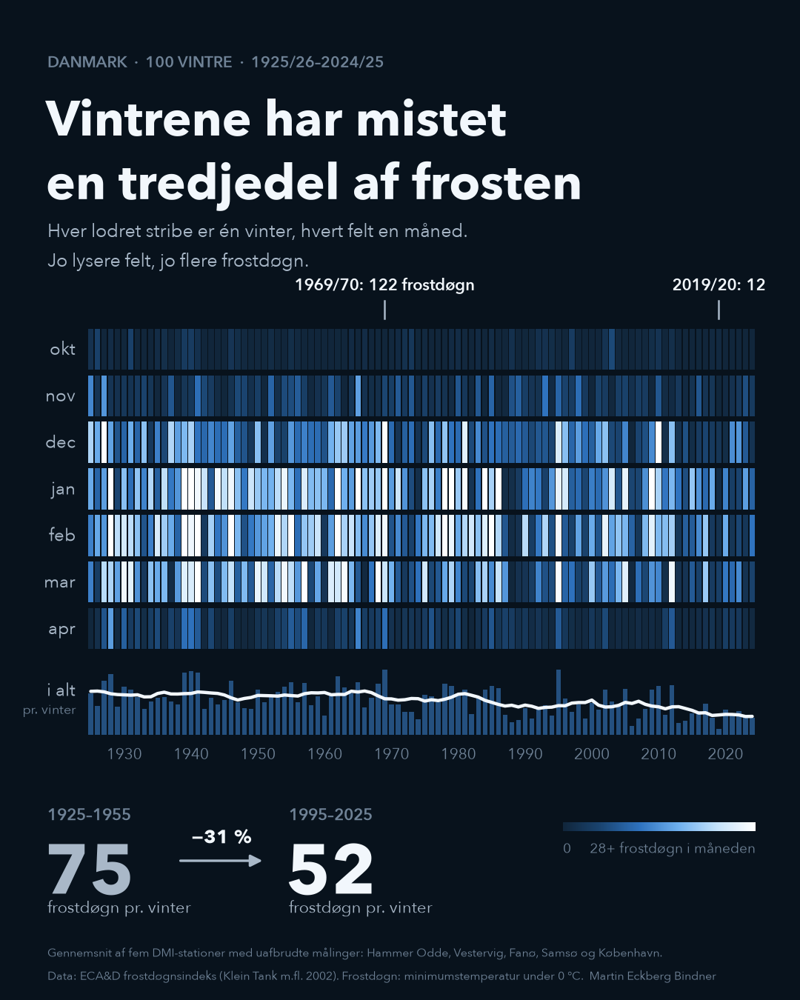
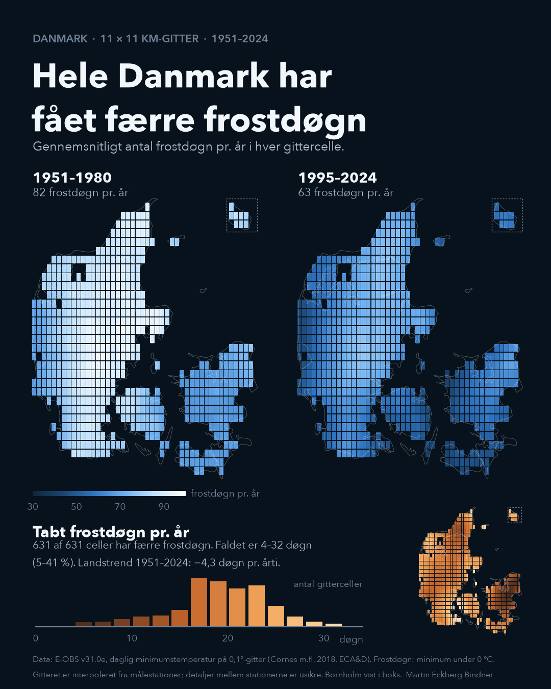
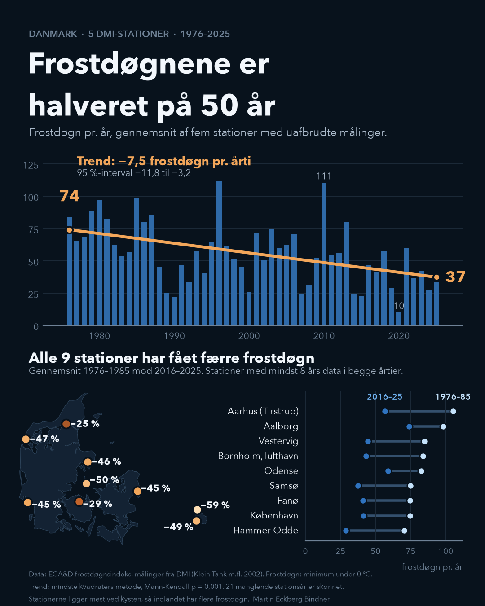

# Fewer frost days in Denmark

Denmark has half as many frost days as 50 years ago.







A frost day is a day when the minimum temperature falls below 0 °C. Across five DMI stations with unbroken records, the linear trend falls from **74 frost days a year in 1976 to 37 in 2025**: −7.5 days per decade (95 % interval −11.8 to −3.2; Mann-Kendall p = 0.001). All nine stations with data in both 1976–85 and 2016–25 lost frost days, by 25–59 %.

Over 100 winters (October–April), the average fell from 75 frost days per winter in 1925–1955 to 52 in 1995–2025 (−31 %). The coldest winter was 1969/70 (122 frost days), the mildest 2019/20 (12).

On the E-OBS 0.1° grid (about 11 × 11 km), every one of Denmark's 631 land cells has fewer frost days in 1995–2024 than in 1951–1980: on average 63 against 82 per year, a drop of 4–32 days (5–41 %) per cell. The national grid trend for 1951–2024 is −4.3 days per decade (±2.3).

The image labels are in Danish. The images are meant as a carousel: the cover, the map, then the trend analysis.

## Run

```
python3 py/fetch.py    # downloads ECA&D FD index (~24 MB) and a Natural Earth outline
python3 py/hero.py     # writes output/frost_season_final.png (cover)
Rscript R/eobs_frost_days.R   # needs data/raw/tn_ens_mean_0.1deg_reg_v31.0e.nc, see Data
python3 py/map.py      # writes output/frost_map_final.png (map)
python3 py/figure.py   # writes output/frost_days_final.png (trend analysis)
```

`python3 py/analysis.py` prints the trend, decade means and per-station changes. Only the Python standard library and matplotlib are needed.

## Data

- **ECA&D**, frost-day index FD (annual count of days with TN < 0 °C) for Danish stations. Measurements are DMI's. Klein Tank, A.M.G. et al. 2002, *Int. J. Climatol.* 22, 1441–1453. ECA&D data may be used for non-commercial research and education with this citation.
- **E-OBS v31.0e**, daily minimum temperature on a 0.1° grid, ensemble mean, 1950–2024 (Cornes et al. 2018, *J. Geophys. Res. Atmos.* 123, 9391–9409). Download `tn_ens_mean_0.1deg_reg_v31.0e.nc` (4.9 GB) from ECA&D into `data/raw/`. Same ECA&D terms as above.
- **Natural Earth** 1:10m country outline, via `world-atlas`.

DMI's own open climate API only has Danish frost-day counts from 2011, which is why ECA&D is used.

## Method

1. **National series.** Mean of the five stations with complete records since the 1870s: Hammer Odde (Bornholm), Vestervig, Nordby (Fanø), Tranebjerg (Samsø) and København (Landbohøjskolen). 21 of 500 station-years in 1926–2025 are missing; each is filled with the station's 1961–90 mean plus the other stations' anomaly that year.
2. **Months.** The same five-station mean per month, gaps filled the same way per calendar month. A winter is October to April; May and September average under 0.2 frost days at these stations.
3. **Trend.** Ordinary least squares on the 50 annual values 1976–2025, with a t-based 95 % interval for the slope. A Mann-Kendall test confirms the trend without assuming linearity.
4. **Stations.** ECA&D lists some series more than once; series that match another on ≥ 10 shared years are dropped. Stations need at least 8 years in both 1976–85 and 2016–25.
5. **Grid.** Frost days per cell and year are counted from daily E-OBS minimum temperature in R (terra). Cells are kept if their centre, or a point 0.04° from it, is on Danish land in Natural Earth: 631 cells. Periods are 1951–1980 and 1995–2024, the last full 30 years in E-OBS. At the five long stations, the grid change agrees with the station change within 1–6 days.

## Limitations

- The five long series are mostly coastal, so the level is lower than inland Denmark. The change over time is what the figure is about.
- Year-to-year variation is large (10 frost days in 2020, 111 in 2010), so the endpoints of the trend line are the fitted values, not single years.
- E-OBS is interpolated from stations and is not homogenised, and Denmark had few stations in ECA&D before 2011. The national picture is robust; differences between regions (for example the small drop on eastern Zealand) may partly reflect the station network.
- The station comparison covers nine stations; most of the network only enters ECA&D from 2011.

## Licence

Code: MIT. Images: free to share and adapt with credit for non-commercial use only, because ECA&D and E-OBS data are licensed for non-commercial research and education.
